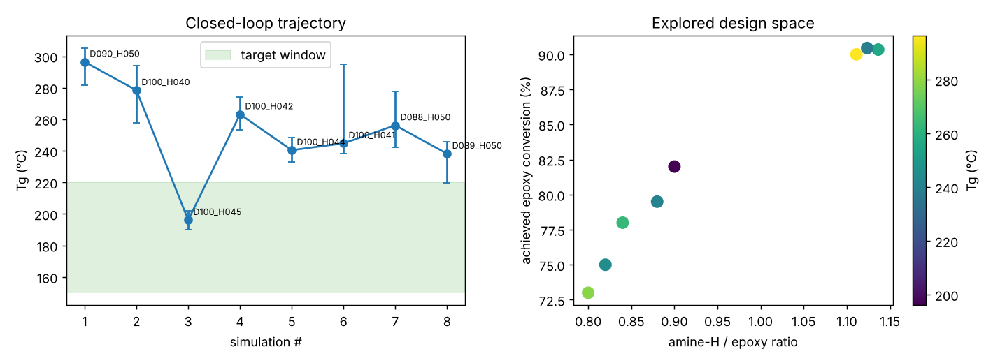

# Glass Act: Autonomous Formulation Optimizer

*A closed-loop workflow that proposes epoxy formulations, checks their chemistry, evaluates molecular-dynamics results, and learns which formulation to try next.*

**Team:** Deck-group  
Built for the [LLM Hackathon for Applications in Materials & Chemistry 2026](https://llmhackathon.github.io/).

## Goal

Find a DGEBA/4,4′-DDS epoxy formulation with a glass transition temperature (**Tg**) in a configurable target window (default **150–220 °C**). The search varies resin/hardener molecule counts and degree of cure across **23 buildable formulations**.

## How it works

1. **Bayesian optimizer** proposes a formulation (initial exploration, then a Gaussian-process surrogate).
2. **Experiment agent + PhysCheck** verify stoichiometry, achievable cure, structure, and charge.
3. **Simulation backend** retrieves precomputed LAMMPS results (`replay`) or prepares HPC jobs (`slurm`).
4. **Post-PhysCheck** evaluates Tg uncertainty and result plausibility.
5. **Learning loop** stores valid observations and updates the optimizer.

Core implementation: `run_workflow.py`, `workflow/stages.py`, and `packages/{BO,Agents,Simulations}/`.

## Results

The reference demo (`runs/demo/`) searched **8 formulations with completed MD** and found a target-window hit on iteration **3**:

| Formulation | Amine-H/epoxy ratio | Cure | Tg |
|---|---:|---:|---:|
| **D100_H045** | **0.90** | **82%** | **196 °C** (95% CI: 190–202 °C) |

All eight results passed the physics checks. The demo hit the window in 3 evaluations, versus 4.5 on average for random search over the same eight candidates.



## Quick start

Requires **Python 3.10+**. Replay mode needs no LAMMPS installation or HPC access.

```bash
pip install -r requirements.txt
python run_workflow.py --run-name my_run
```

Useful options:

```bash
python run_workflow.py --stop-on-target
python run_workflow.py --tg-min 230 --tg-max 250 --run-name alt
python run_workflow.py --pool all --run-name full
python run_workflow.py --backend slurm --run-name cluster
```

Results are saved in `runs/<run-name>/`, including `summary.json`, `observations.csv`, `events.jsonl`, simulation job files, and `trajectory.png`. Configuration lives in `config/experiment.json`. To incorporate additional MD results, update `data/md_results_carbono.csv` and run with `--pool all`.

## Tests

```bash
python -m unittest discover -s tests -v
```

Package-specific tests are available under `packages/BO/` and `packages/Agents/`.

## Limitations and next steps

- **Replay is retrospective:** it uses real, previously computed HPC results; `slurm` prepares new simulation jobs but does not execute them locally.
- **Classical force field, not MLIP production MD:** PET-MAD was benchmarked but was too slow for full Tg scans.
- **Preliminary Tg values:** fast MD cooling and a single network realization per formulation limit experimental comparability; reported CIs reflect within-trajectory sampling.
- **Only 8 measured formulations:** the GP demonstrates the learning architecture, not a validated predictive model.

Next: simulate the remaining 15 formulations, add network replicas, extend the component library, and explore MLIP validation and LLM-assisted failure analysis.

## Team — Deck-group

Developed collaboratively by the **Deck-group** team. Contributions include Bayesian optimization (`packages/BO/`), experiment agents and physics validation (`packages/Agents/`), molecular-dynamics simulations (`packages/Simulations/`), and workflow integration.

**Team members:** Arthur da Silva Sousa Santos; Adib Bazgir; Elena Stojanovska; Nannan Zhang; Xiaoli Yan; Matheus Rodrigues de Amorim Medina

## Credits

Force field and starting structures: [Livraghi et al. (Zenodo)](https://zenodo.org/records/7273800). Tg methodology: [Orselly et al.](https://pmc.ncbi.nlm.nih.gov/articles/PMC9434774/). Simulations were run on the Carbono HPC cluster.
